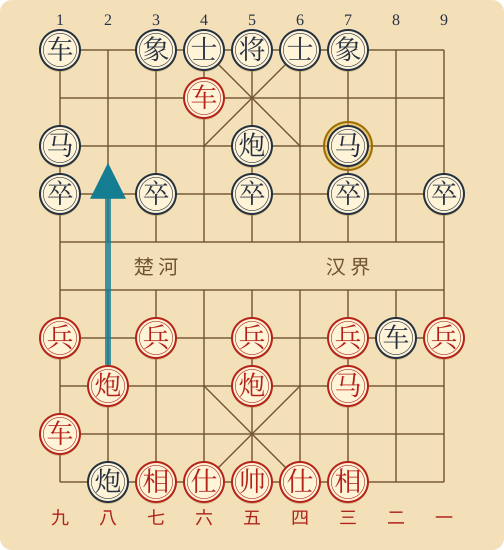
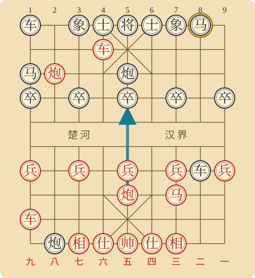
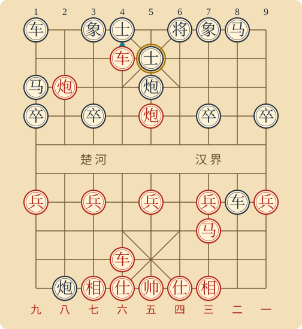
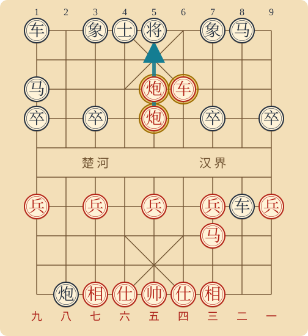

# 弃马十三着：配图讲解

这是一盘顺炮横车对直车的古谱攻杀示范局。关键思路是先调离守子，再打开中路，通过车炮配合形成重炮杀。[公开棋谱](https://zh.wikipedia.org/wiki/弃马十三着)提供完整主线。

各图均为红方在下，黑方在上；底部为红方路数，顶部为黑方路数。蓝箭头表示本节推荐走法或终局攻击线，黄圈标出关键棋子。每图标明局面发生回合、轮到谁走和推荐着法。

可下载 [交互讲解 HTML](index.html) 后用浏览器打开，在四个关键局面及错误变例之间切换。下方 SVG 可直接在 GitHub 阅读。

## ① 先赶马

第6回合黑方炮2进7后，轮到红方。

**炮八进五！**

蓝箭头为推荐走法，黄圈是黑方守中卒的马。红边炮升至八路，以黑中炮为炮架攻击黑马。谱中马7退8之后，红方才有炮五进四的突破。

## ② 再吃中卒

第7回合黑方马7退8后，轮到红方。

**炮五进四＋**

黑马已离开原先的防守点。这时红中炮以本方中兵为炮架，吃中卒并将军。注意：先赶马，再吃卒，次序不能倒。

## ③ 弃车催攻

第9回合黑方将5平6后，轮到红方。

**前车进一＋**

前车吃底士并将军。主线黑士5退4吃车后，红后车六平四将军；黑炮5平6垫将，红车四进六吃炮再将军。黑方也可改走将6进1，须另算变化。

## ④ 重炮将死

第13回合红方炮八平五后，轮到黑方，黑方被将死。

**重炮杀，红胜**

中路前炮给后炮架炮；红四路车封住黑将6路的将门，黑士堵住4路将门。黑将向前一步仍在后炮火力内。即使象7进5吃前炮，黑象也会继续成为后炮的炮架。

## 棋谱主线
每行一回合，红先黑后。黑方按下列应手时，第13回合重炮将死。
| 回合 | 红方 | 黑方 |
| --- | --- | --- |
| 1 | 炮二平五 | 炮8平5 |
| 2 | 马二进三 | 马8进7 |
| 3 | 车一进一 | 车9平8 |
| 4 | 车一平六 | 车8进6 |
| 5 | 车六进七 | 马2进1 |
| 6 | 车九进一 | 炮2进7 |
| 7 | 炮八进五 | 马7退8 |
| 8 | 炮五进四 | 士6进5 |
| 9 | 车九平六 | 将5平6 |
| 10 | 前车进一 | 士5退4 |
| 11 | 车六平四 | 炮5平6 |
| 12 | 车四进六 | 将6平5 |
| 13 | 炮八平五 | 红胜 |

注意：第10回合黑方也可将6进1，后续需要另算。因此这里展示的是古谱主线及其战术原理，不能当作对任意防守都成立的十三回合必胜法。
